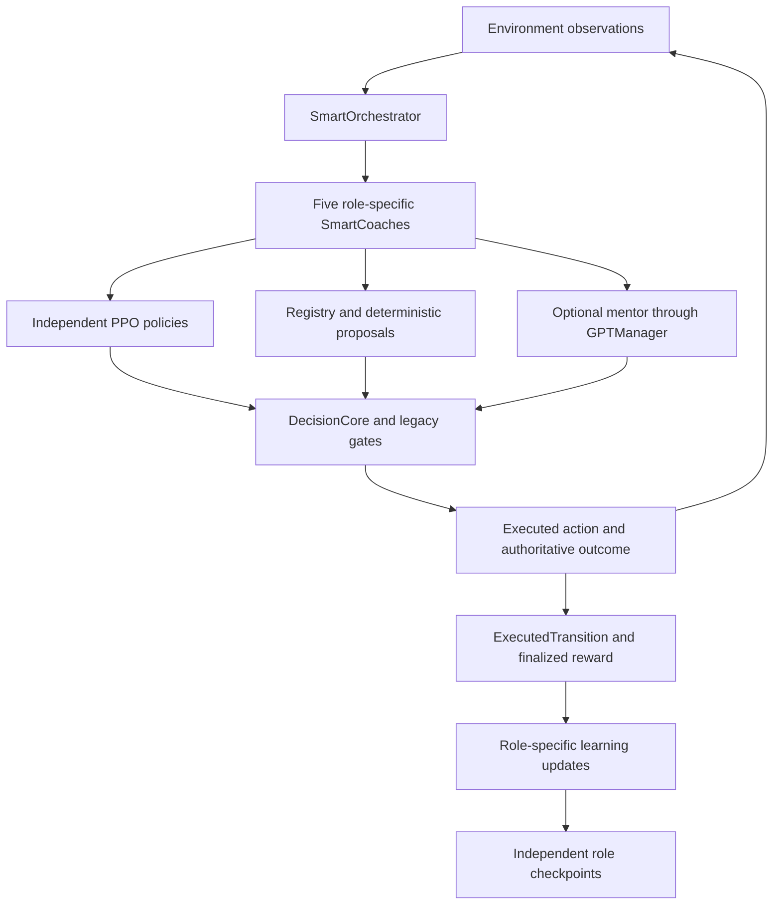

# Ariaska_RL

**Independent reinforcement-learning policies with optional model mentorship.**

Ariaska_RL is an experimental research framework for studying how five agent
policies learn from executed outcomes, retain independent state and use optional
language-model guidance. Its cybersecurity components are intended for explicitly
authorized, isolated labs. The reproducible research baseline uses a synthetic
CPU environment with no live targets or paid model calls.

[Research evidence](docs/controlled_merge_validation.md) ·
[Reproducibility](docs/reproducibility.md) ·
[Contributing](CONTRIBUTING.md) · [Roadmap](ROADMAP.md)

> **Research preview; source-available.** The current [non-commercial license](LICENSE)
> is not an open-source license. A proposed AGPL-3.0-only migration is on hold
> pending contributor and third-party rights clearance. See the
> [licensing decision](docs/licensing-review.md). This repository is not production-ready.

## Research questions

- Can independent role policies learn useful behavior while deterministic rules and
  optional mentors also propose actions?
- Can a learner receive credit only for the action that actually ran, preserving
  the probability context needed by PPO?
- Can each role's policy, optimizer and learning state survive checkpoint restore
  without accidentally sharing or overwriting another role's state?
- Which benefits of mentorship remain when the mentor is removed, and which
  claims survive controlled ablations and held-out evaluation?

The October recovery work establishes a bounded learning and persistence baseline.
It does not yet answer all of these questions. The [roadmap](ROADMAP.md) states the
remaining experiments and their acceptance criteria.

## Architecture



The diagram describes the research path. DecisionCore is central, but some legacy
paths have separate deterministic gates. The offline adapter executes opaque
action IDs; it does not execute cybersecurity command strings.

| Component | Responsibility | Source |
| --- | --- | --- |
| Orchestration | Bounded episodes, role coordination and checkpoint lifecycle | [SmartOrchestrator](core/orchestration/smart_orchestrator.py) |
| Five roles | Scout, Red, Blue, Shadow and Orion have separate policies and optimizers | [Agents](core/agents/) |
| Action arbitration | Policy, registry and mentor proposals; executed-action ownership | [SmartCoach](core/training/smart_coach.py), [ExecutedTransition](core/training/executed_transition.py) |
| Learning | PPO sampling/update contracts and auxiliary learning paths | [PPO](core/algorithms/ppo_agent.py) |
| Mentor–apprentice path | Optional local/cloud advice and behavioral-cloning signals | [GPTManager](core/gpt_manager.py), [mentor policy](core/training/mentor_policy.py) |
| Research environment | Seeded synthetic observations and opaque actions | [Synthetic environment](core/testing/synthetic_role_env.py) |

Agent identity is independent of a model provider. `ARIASKA_MENTOR_BACKEND=none`
disables mentorship; this still permits policy and deterministic registry
choices. A mentor-free result is not automatically a PPO-only result.

## Evidence and limits

| Evidence | What it supports | Boundary |
| --- | --- | --- |
| October 2026 controlled validation | Historical local result: 3,318 tests passed, 6 skipped | CPU, guarded fixtures; not proof of live operation |
| Post-merge [Offline recovery run](https://github.com/Reckless98/Ariaska_RL/actions/runs/39069273198) | Successful CI on `d2f72fee` | A historical run, not a result for this PR |
| Three-seed synthetic study | 96.18% mean trained accuracy vs 49.31% frozen; trained across-seed SD 3.58 percentage points | Two legal choices, PPO-focused arbitration, greedy base-policy evaluation |
| Current readiness checks | Metadata, protective checks and retained-evidence verification | See [dated results](docs/reproducibility.md); the full operational suite was not rerun in this task |

The synthetic study used seeds 11/22/33, 40 training episodes and 128 held-out
episodes per seed, each with eight choices. Results were recorded at experiment
commit `878586cffa2354cec4c843ba344309e4ce786845`. All five role means improved;
Shadow seed 11 reached 73.44%, so aggregate accuracy does not erase role variance.
These are descriptive results, not a confidence interval or evidence of
cybersecurity capability, collaboration advantage or general intelligence.

The earlier 68.22% result, including Orion's below-chance result, remains in the
[original recovery report](docs/recovery_validation.md). The later
[integration study](docs/integration_merge_readiness.md#repeated-seed-learning-evidence)
retains aggregate metrics, per-role summaries, source hashes and repeatability
records; its later raw CSVs are not tracked in the reviewed tree. Raw CSVs are
retained for the earlier study. Neither is relabeled as a new experiment.

## Start with the offline research materials

Python 3.12 and the pinned CPU dependency set are the documented recovery
baseline, retained for reproduction; the [dated audit](docs/reproducibility.md)
reports unresolved dependency advisories. A lightweight checkout excludes working
copies of the `models`, `checkpoints`,
`data`, `logs`, `runs`, `results` and `reports` directories. It is not a cleared
release manifest and other historical files can remain:

```bash
git clone --filter=blob:none --no-checkout https://github.com/Reckless98/Ariaska_RL.git
cd Ariaska_RL
git sparse-checkout set --no-cone '/*' '!/models/' '!/checkpoints/' '!/data/' '!/logs/' '!/runs/' '!/results/' '!/reports/'
git checkout research/oss-readiness-2026-11-23
```

The branch above contains this review proposal. Use `master` only after the
modernization has been reviewed and merged there. Then
`python3 scripts/check_repository_metadata.py` checks the documentation metadata
without launching the application. The [reproducibility guide](docs/reproducibility.md) separates current checks from the
historical full-suite procedure and explains dependencies, seeds and outputs.
Do not treat `launch.py`, the live CLI or historical lab commands as a quick-start
verification step.

Optional provider integration is useful for studying advice quality, intervention
budgets and retention of learned behavior. It is not required to read the evidence
or perform metadata validation. Provider access is separately configured and must
follow the provider's terms; do not commit credentials or captured private data.

## Research status

- Default-arbitration learning, broader task families and feature-identical
  evaluation remain open research work.
- Checkpoints preserve tested learning state; they do not restore an external
  environment or every experimental controller.
- Physical-GPU replay, live-provider behavior and optional integrations are not
  established by the CPU evidence.
- The Python offline guard is a trusted-code test harness, not an operating-system
  security boundary for hostile code.
- Corpus redistribution and model provenance require review before any open-source
  release. Public availability is not a substitute for permission.

## Contribute and cite

Useful contributions include evidence checks, documentation corrections,
reproducibility improvements and carefully scoped safety reviews. Start with
[CONTRIBUTING.md](CONTRIBUTING.md), [SECURITY.md](SECURITY.md) and the
[maintainer policy](MAINTAINERS.md). Historical component descriptions are in
[architecture and phase notes](docs/history/architecture-and-phases.md).

Use [CITATION.cff](CITATION.cff) and include the exact commit and experiment
configuration in research citations. There is no published versioned release or
DOI to imply. The [research-preview proposal](docs/research-preview.md) describes
the release gates; it is not a published release.

Copyright (c) 2024–2026 Filip Volf. See [AUTHORS.md](AUTHORS.md), the current
[LICENSE](LICENSE), and the [third-party inventory](docs/third-party-inventory.md).
