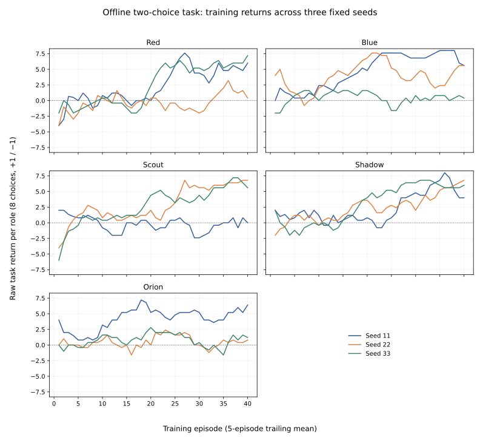
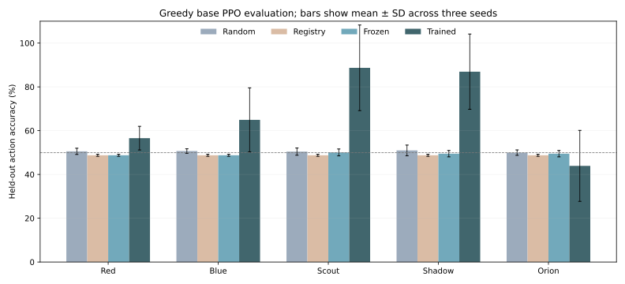

# Recovery validation — 17 October 2026

This document supersedes historical architecture/audit claims where they conflict.
The recovery branches are proposals, not merged master. Review PRs #6 through #13
in dependency order; the owner retains merge approval. Follow-up integration hardening is
in [PR #14](https://github.com/Reckless98/Ariaska_RL/pull/14); its
[merge-readiness report](integration_merge_readiness.md) records the newer evidence and review dispositions.

**Status: PARTIAL research readiness.** The bounded native offline MDP path is
verified through all five independent PPO policies, execution attribution,
updates, checkpoints, restoration and continued training. This does not establish
live cybersecurity capability or reliable learning by every agent.

## Verified contracts

| Contract | Implementation | Evidence |
|---|---|---|
| Executed outcomes, separate from proposals | `ExecutedTransition`, `SmartCoach.record_result` | All five role ownership/replacement tests; native and legacy deterministic-source integration |
| Behavior probability replay | `PPOAgent.select_action`, `evaluate_actions`, rollout behavior context | 15 dimension/head combinations; unchanged-parameter ratios 0.999999523–1.0 with masks/bias/prior and dropout configured |
| Terminal/truncation/GAE | Explicit next-state value, terminal flag, recurrence boundary and chronological IDs | Terminal, time-limit and unfinished bootstrap; episode isolation; short final minibatches |
| Policy ownership | Red 79, Blue 18, Scout 37, Shadow 54, Orion 12 | Each owns its PPO and optimizer; no reward assigned to rejected PPO/SAC proposals |
| Persistence | `UnifiedCheckpoint` v3 role maps, policy/optimizer/resume/RNG data | Five distinct fingerprints, corruption preflight, rollback, failed-save preservation and subsequent updates |
| Mentor integration | Actual SmartMentor → GatewayChatClient → GPTManager, in-memory providers | JSON/retry/cache/usage tests; all-role accepted/unmapped/fallback teacher cases |
| Training lifecycle | Requested episode count and hard step cap; periodic/final PPO updates | Three episodes per role, terminal/truncated variants, repeatability, interruption and learning-error saves |

PPO receives the shared finalized reward before its documented compression and
normalization. PPO-only post-hoc terminal/HTR relabeling and value-surprise additions
to an already finalized reward were removed. DDQN retains its explicit macro-level
shaping objective. Dedicated SIL/BC losses remain distinct learning objectives;
historical SIL samples never masquerade as fresh on-policy rollouts.

Native action handling requires an explicit trusted step-context flag set by the
offline adapter; an observation key alone cannot activate it. Deterministic
cybersecurity gates and some early source paths remain. Their
results receive execution metadata and do not inherit another proposal's PPO
sample. DecisionCore is therefore a central arbiter, **not the exclusive action
authority in every legacy path**.

## Reproduce safely

Validated with Python 3.12, CPU PyTorch 2.14.1+cpu, NumPy 2.5.4 and pytest 9.1.1.
Exact installed versions are in [`requirements-recovery.lock`](../requirements-recovery.lock).
These are the tested environment, not a claim that every optional project
integration is installed or compatible. Matplotlib 3.10.8 was used only to render
the committed plots and is not required for training.

```bash
python3.12 -m venv .venv-recovery
.venv-recovery/bin/python -m pip install --extra-index-url https://download.pytorch.org/whl/cpu -r requirements-recovery.lock
export ARIASKA_MENTOR_BACKEND=none
export ARIASKA_DRY_RUN=1
export ARIASKA_DATA_DIR="$(mktemp -d)"
PYTHONPATH=. .venv-recovery/bin/python -m pytest -p core.testing.offline_guard tests/recovery --timeout=60 -q
PYTHONPATH=. .venv-recovery/bin/python -m pytest -p core.testing.offline_guard tests --timeout=45 -q
.venv-recovery/bin/python scripts/evaluate_recovery.py --output /tmp/ariaska-new-experiment --seeds 11 22 33 --episodes 40 --horizon 8 --evaluation-episodes 128
```

The evaluation output directory must be empty; all existing artifacts are preserved.
An exclusive marker reserves it for one evaluator. The evaluation script imports the network/process guard before
application code, uses temporary stores and never executes command strings.
`ARIASKA_DRY_RUN=1` resolves the existing DETERMINISTIC feature profile, disabling
LLM features. Exact flags and source hashes are recorded in the evidence.

A separate fresh-interpreter probe denies imports of OpenAI, Anthropic,
Transformers, Hugging Face Hub and LangChain, then trains all five roles for two
episodes with zero provider requests. Reproduce with:

```bash
.venv-recovery/bin/python scripts/verify_mentor_free.py --output /tmp/ariaska-no-sdk.json
```

Its [result](evidence/recovery_2026-10-17/mentor_free_no_sdk.json) confirms that
mentor-free execution does not require those LLM libraries. It still needs the
ordinary application/RL dependencies.

The guard intentionally blocks child processes and tool availability probes.
Five existing tests consequently fail under this command; do not interpret a
zero subprocess count as validation of those subprocess/CLI paths.

## Full-suite result

**3,239 passed; 5 failed due to the guard; 10 skipped** (45.38 seconds as reported
by pytest). Sixteen network/process attempts were blocked; none executed. The
machine-readable [summary](evidence/recovery_2026-10-17/full_suite_summary.json)
lists every failed and skipped test with its reason. No failure was converted to
a skip and no assertion was deleted to obtain this result.

The first guarded recovery run exposed eight obsolete RND/SAC fixtures that bound
observed rewards to a stale pending proposal, including an unmapped Scout command
used for Red. The fixtures now bind real role-valid policy samples; original
assertions remain, action identity checks were added, and a permissive reward
comparison was strengthened to equality. Five pre-existing subprocess/tool tests
remain guard-blocked. Two online tests remain unexecuted without credentials;
none were supplied.

## Fixed-budget learning experiment

The task is deliberately small: a port-21/22 observation encodes a binary cue.
The correct opaque action is index 0/1. Each role retains its full output head,
but only those two actions are legal. Correct/incorrect choices earn +1/−1; an
episode contains eight choices. No command template is executed. All baselines
receive the same held-out cue sequences and legal action set.

Three fixed seeds (11, 22, 33), 40 training episodes per seed, then 128 held-out
episodes per seed. Every role completed 40 PPO updates per seed; provider requests
and blocked execution attempts were both zero. No hyperparameters or task rules
were tuned after observing results. Arbitration weights were declared in advance:
PPO=2 and other sources=.01, a PPO-focused ablation rather than the default mix.

Evaluation measures the **greedy base PPO policy** using the base state encoder,
legal-action mask and phase head 0. It omits training-time cyber heuristic logit
biases/mentor priors and richer coach context inputs. It is an intentionally
limited policy diagnostic, not a feature-identical benchmark of the full default
SmartCoach deployment policy. The frozen baseline uses initial weights; the
registry baseline selects the first legal mapped action; random is uniform over
the same two legal actions. Training curves describe the actual stochastic
SmartCoach training decisions, so they can differ from this base-policy evaluation.

| Baseline | Held-out action accuracy, mean ± SD across seeds | Mean role episode return (−8 to +8) |
|---|---:|---:|
| Random | 50.52% ± 0.41 points | +0.083 |
| Registry-only | 48.76% ± 0.46 points | −0.198 |
| Frozen PPO | 49.31% ± 1.00 points | −0.110 |
| Trained PPO | 68.22% ± 3.08 points | +2.915 |

| Role | Trained accuracy by seed 11 / 22 / 33 | Mean ± SD |
|---|---:|---:|
| Red | 61.62 / 50.88 / 57.23% | 56.58% ± 5.40 points |
| Blue | 71.19 / 75.39 / 48.24% | 64.94% ± 14.61 points |
| Scout | 66.11 / 100.00 / 100.00% | 88.70% ± 19.56 points |
| Shadow | 67.48 / 93.36 / 100.00% | 86.95% ± 17.18 points |
| Orion | 57.52 / 25.98 / 48.24% | 43.91% ± 16.21 points |

All-eight-choice completion averaged 24.74% for trained policies, versus 0.36%
random, 0.52% registry and 0.73% frozen. These small-sample completion rates and
three-seed SDs are descriptive, not confidence intervals or significance claims.

**All five can update and restore. Reliable useful learning by all five is not
established.** Orion is below chance on average; Blue stalls for one seed. The
aggregate gain must not hide those outcomes. Only two actions per head were
trained, held-out scenarios vary cue sequences, and this measures no security
capability, collaboration advantage, long-horizon planning or generalization to
new task families.

An earlier measurement using a pre-correction teacher-label path was discarded.
Only final corrected results are included here. The experiment's four source
hashes match the reliability commit `688a0efd07825fd3e0f32aba52eb7f27c7b98106`.
The subsequent proposal-lifecycle commit changes discarded-proposal cleanup and
legacy deterministic-source metadata and requires explicit native context; it does
not change this MDP's policy/loss code.
The delivery suite covers that final follow-up.





Raw evidence: [configuration/results](evidence/recovery_2026-10-17/metrics.json),
[training CSV](evidence/recovery_2026-10-17/training_curve.csv),
[held-out CSV](evidence/recovery_2026-10-17/heldout_results.csv),
[probability checks](evidence/recovery_2026-10-17/numerical_contract.json),
[actual training-step trace](evidence/recovery_2026-10-17/execution_trace.json).

## Checkpoint and resume boundary

`UnifiedCheckpoint.from_coaches(...).save(new_path)` captures independent role
policies, optimizers, SAC replay/entropy optimizer, available DDQN state, BC/SIL/
rollout metadata and Python/NumPy/torch CPU plus per-device CUDA RNG state. `load(...).apply_coaches(...)`
validates all roles and action maps before installing, and rolls back a failed
installation. Atomic same-directory replacement protects an existing file if
serialization fails; supported platforms also sync the containing directory. SAC and
unified loading are restricted, with no arbitrary-pickle fallback; see the
[compatibility boundary](integration_merge_readiness.md#compatibility-and-operational-boundaries).
Capture/apply require quiescent training. Existing single-policy formats can be imported explicitly
into a compatible role; they are not broadcast during automatic loading.

`run_training(episodes=N)` honors N, saves completed episodes to configured
`checkpoint_dir`, and propagates learning errors. An interrupted episode finalizes
valid partial transitions and writes a separately named checkpoint tagged as
interrupted. Failures are not reported as successful learning.

This is learning-state persistence, **not an exact external-environment snapshot**.
Campaign/global auxiliary state, every adaptive controller and live sessions are
not comprehensively restored. CUDA RNG capture/restore is implemented and mocked;
physical GPU resume is unverified. Resume into a fresh bounded episode
unless the environment owner independently restores its state. The separate
legacy global five-action PPO and some advanced controllers still require an
integration study; they are not the five verified role policies.

## Remaining work

1. Investigate role-dependent variance and robustness with feature-
   identical inference and controlled schedule/auxiliary ablations. Preserve the
   historical baseline and the newer three-seed 96.18% result in the integration
   report; neither is a general learning guarantee.
2. Measure default arbitration, including policy-selection bias from admitting
   only some PPO proposals. Its learning behavior is not proved by ratio identity.
3. Specify complete experiment/environment/controller resume semantics. Role
   checkpoint correctness does not imply bitwise mid-engagement resume.
4. Establish end-to-end evidence for DAgger consumption, Reptile/meta controllers,
   reward-learning efficacy and other auxiliary paths. DAgger now collects real
   labels/states; it is not a demonstrated training consumer in this path.
5. Test child-process CLI wiring in a separately isolated approved harness.
   Tool probes remain blocked here; optional Optuna and online tests are not run.
6. Provider threads are bounded, but a non-cooperative SDK cannot be forcibly
   stopped safely in a Python thread. Transport timeouts and backpressure remain
   necessary; no live provider behavior was measured.

The project now has an auditable offline RL execution substrate and reproducible
negative as well as positive results. It remains experimental, not production-ready.
